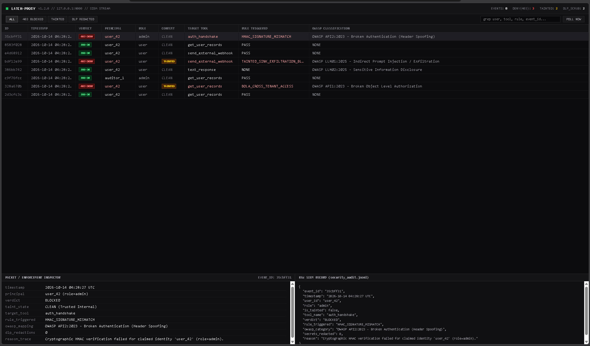

# latch-proxy


An enterprise-grade, zero-trust FastAPI reverse proxy and runtime security gateway that defends LLM-integrated applications and APIs against **9 OWASP API & LLM Top 10 threat categories** using deterministic runtime controls.

---

## Live SecOps Packet Inspector (`/dashboard`)



---

## 8-Layer Defense-in-Depth Architecture (v3.0)

1. **HMAC-SHA256 Session Binding (`app/context.py`, `app/crypto.py`):** Verifies cryptographic session signatures (`X-Latch-Signature`) via constant-time comparison (`hmac.compare_digest`) and locks `user_id` and `role` into a frozen server-side state object (**OWASP API2:2023**).
2. **Sliding-Window Rate & Denial-of-Wallet Guard (`app/ratelimit.py`):** Enforces per-principal monotonic sliding-window rate limits and maximum prompt token/character quotas (`HTTP 429`) (**OWASP API4:2023 & OWASP LLM10:2025**).
3. **Anti-Steganography & Input Deobfuscator (`app/normalizer.py`):** Strips invisible zero-width Unicode tag-smuggling characters, applies NFKC homoglyph normalization, and recursively surfaces suspicious Base64-encoded instructions before model ingestion.
4. **Cryptographic Spotlighting & Canary Honeytokens (`app/delimiter.py`, `app/canary.py`):** Wraps untrusted external context inside per-request hex boundaries (`[[UNTRUSTED_DATA_START_<hex>]]`) and embeds secret `LATCH-CANARY-<hex>` honeytokens into system instructions to detect and block system prompt extraction (**OWASP LLM07:2025**).
5. **Dynamic Taint-Tracking Engine (`app/taint.py`):** Automatically taints the request execution state whenever untrusted external context is ingested, blocking downstream network/destructive sink tools (`send_external_webhook`, `delete_user_account`) to stop data exfiltration (**OWASP LLM01:2025**).
6. **Deterministic BOLA & RBAC Policy Engine (`app/guard.py`, `policies.json`):** Validates every model-generated tool call against role allowlists and strict resource ownership (`target_user_id == session.user_id`) (**OWASP API1:2023 & OWASP API5:2023**).
7. **Deep Tool-Argument SSRF & Injection Firewall (`app/inspector.py`):** Inspects tool-call arguments to block Server-Side Request Forgery against cloud metadata (`169.254.169.254`), loopback, and RFC1918 private networks (**OWASP API7:2023**), as well as path traversal (`../`) and shell injection (**OWASP LLM05:2025**).
8. **Shannon Entropy DLP & Tamper-Evident SHA-256 SIEM Ledger (`app/scrubber.py`, `app/audit.py`, `app/dashboard.py`):** Redacts known credential patterns and high-entropy secrets ($H(X) > 4.2$ bits/char) (**OWASP LLM02:2025**), while linking every security event into a verifiable SHA-256 hash chain (`GET /v1/audit/verify`).

---

## Project Structure

```text
latch-proxy/
├── .github/workflows/
│   └── security-ci.yml  # Automated 15-stage security CI pipeline
├── app/
│   ├── main.py          # FastAPI reverse proxy & routes (/v1/chat, /v1/audit, /v1/audit/verify, /dashboard)
│   ├── context.py       # Immutable session lock & header verification
│   ├── crypto.py        # Constant-time HMAC-SHA256 signature verification
│   ├── ratelimit.py     # Monotonic sliding-window rate & quota limiter
│   ├── normalizer.py    # Zero-width steganography, NFKC & Base64 deobfuscator
│   ├── delimiter.py     # Per-request cryptographic boundary spotlighting
│   ├── canary.py        # Per-request honeytoken generator & leak detector
│   ├── taint.py         # Dynamic taint-tracking state engine
│   ├── guard.py         # Deterministic RBAC, BOLA & taint sink enforcement
│   ├── inspector.py     # Deep tool-argument SSRF & command/path injection firewall
│   ├── scrubber.py      # Regex + mathematical Shannon entropy DLP scrubber
│   ├── audit.py         # Tamper-evident SHA-256 hash-chained SIEM logger
│   └── dashboard.py     # Split-pane SecOps packet inspector UI
├── assets/
│   └── dashboard.png    # SecOps console telemetry screenshot
├── Dockerfile           # Hardened non-root container build (UID 10001)
├── SECURITY.md          # Vulnerability disclosure policy
├── policies.json        # Declarative tool permissions, BOLA & taint sink rules
├── test_attacks.py      # 15-stage automated security regression suite
└── requirements.txt     # Dependencies
```

---

## Quickstart (Local & Docker)

### Local Python Environment
```bash
python -m venv venv
.\venv\Scripts\Activate.ps1
pip install -r requirements.txt
uvicorn app.main:app --reload
```

### Hardened Docker Container
```bash
docker build -t latch-proxy:v3.0 .
docker run -p 8000:8000 latch-proxy:v3.0
```

* **SecOps Packet Inspector Console:** `http://127.0.0.1:8000/dashboard`
* **SIEM Hash-Chain Verifier:** `http://127.0.0.1:8000/v1/audit/verify`
* **Interactive OpenAPI Docs:** `http://127.0.0.1:8000/docs`

---

## 16-Stage Automated Security Regression Suite

```bash
.\venv\Scripts\python.exe test_attacks.py
```

```text
=== Running latch-proxy Security Suite v3.0 ===

[TEST 1]  Authorized Self-Access (user_42 -> user_42): HTTP 200 | Expected: 200
[TEST 2]  BOLA Cross-Tenant Hijack (user_42 -> admin_01): HTTP 403 | Rule: BOLA_CROSS_TENANT_ACCESS | Expected: 403
[TEST 3]  Authorized Admin Override (role=admin):       HTTP 200 | Expected: 200
[TEST 4]  Egress Secret Scrubber:                       HTTP 200 | Redacted: 2 secrets
[TEST 5]  Tainted Sink Exfiltration (Webhook Blocked):  HTTP 403 | Rule: TAINTED_SINK_EXFILTRATION_BLOCK | Expected: 403
[TEST 6]  Untainted Webhook Call (No external data):    HTTP 200 | Expected: 200
[TEST 7]  Valid HMAC-SHA256 Signed Session:             HTTP 200 | Expected: 200
[TEST 8]  HMAC Role-Spoofing Attack (user -> admin):    HTTP 401 | Expected: 401
[TEST 9]  Denial-of-Wallet / Rate-Limit Burst Block:    HTTP 429 | Rule: RATE_LIMIT_DOS_BLOCK | Expected: 429
[TEST 10] Unbounded Prompt Quota Block (OWASP LLM10):   HTTP 429 | Rule: DENIAL_OF_WALLET_QUOTA_EXCEEDED | Expected: 429
[TEST 11] SSRF Cloud Metadata Block (OWASP API7):       HTTP 403 | Rule: SSRF_INTERNAL_TARGET_BLOCK | Expected: 403
[TEST 12] Zero-Width Steganography Deobfuscation:       HTTP 200 | ZW_Detected: True | Expected: 200
[TEST 13] Canary Prompt Leak Block (OWASP LLM07):       HTTP 403 | Rule: CANARY_SYSTEM_PROMPT_LEAK | Expected: 403
[TEST 14] Shannon Entropy DLP Scrubber:                 HTTP 200 | Redacted: True | Expected: 200
[TEST 15] SHA-256 Audit Chain Verification:             HTTP 200 | Valid: True | Expected: 200
[TEST 16] Wildcard DNS Rebinding SSRF Block (.nip.io):  HTTP 403 | Rule: SSRF_INTERNAL_TARGET_BLOCK | Expected: 403
```